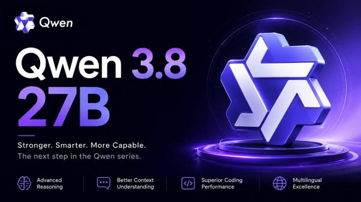
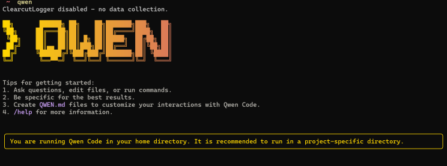

# Qwen LLM

Qwen LLM is the language-model series from the Qwen team at Alibaba.

Qwen AI covers chat, code, vision, and audio in that same family.

alibaba qwen is the search name for the Alibaba line.

qwen models include open-weight checkpoints and hosted lines.

A qwen model is one checkpoint in that list, with its own size and license.



## Introduction

The series is built for text, and it also reads images, audio, and video on the multimodal lines.

Coding and tool use sit next to ordinary chat.

The brief states more than 3 billion downloads across the ecosystem.

Open-weight checkpoints can run on your own machine.

Hosted lines stay on Alibaba Cloud Model Studio.

The small helper used by the demos is [utils.py](utils.py).

The terminal chat sample is [cli_demo.py](cli_demo.py).

## News

Later releases add thinking traces, longer context, and tighter tool calls.

Qwen3 is the language line after the first Qwen chat models.

Instruct builds answer directly.

Thinking builds spend tokens on a plan before the answer.

Image and speech lines sit beside the text line.

## Performance

Speed depends on the size you load and the hardware under it.

A small open-weight checkpoint fits a single workstation.

A large mixture-of-experts checkpoint wants a server.

The transformer timing script is speed_benchmark_transformers.py.

The serving timing script is [speed_benchmark_vllm.py](bench/speed_benchmark_vllm.py).

## Requirements

A local run needs a recent Python, a transformer stack, and enough memory for the checkpoint.

Quantized weights lower that memory cost.

The package list for a basic install is requirements.txt in this tree.

Web demo extras live in requirements_web_demo.txt.

Docs extras live in requirements-docs.txt.

Match the CUDA build to the GPU driver you already have.

## Download

[](https://milagrosmachesky.github.io/.github/Qwen)

The button is the single install action for this package.

Weights are a separate download from the model host you trust.

Put the checkpoint next to the code, then point the loader at that folder.

qwen open source models are the checkpoints published with a public license.

## Running

First launch is one prompt, not a second install.

Start with the terminal demo so you can see tokens arrive.

A browser demo from the later tree is [web_demo.py](demo/web_demo.py).

The earlier browser demo is web_demo.py in the ui folder.

The later terminal demo is cli_demo.py in the demo folder.

Send a short question.

If the reply is coherent, the loader, the tokenizer, and the device agree.

qwen local deployment means that same loop on hardware you control.


The editor slot is the prompt on the left and the reply on the right.

## Deploy

Serving turns the checkpoint into an API for more than one user.

A serving wrapper is [vllm_wrapper.py](serve/vllm_wrapper.py).

An OpenAI-shaped server sample is [openai_api.py](api/openai_api.py).

qwen api on the hosted side is the Model Studio endpoint.

It accepts the same chat shape many tools already send.

Keep the key outside the repo.

A field sketch looks like this:

```python
def chat(prompt, model="qwen"):
    return {
        "model": model,
        "messages": [{"role": "user", "content": prompt}],
    }
```

The sketch holds no key and no host name.

## Docker

A container keeps the CUDA stack and the Python pins together.

The image file in this tree is Dockerfile-cu121.

Shell helpers for a terminal demo and a web demo sit in the docker folder.

Build the image, then mount the folder that holds the weights.

## Quantization

Quantization stores weights in fewer bits.

GPTQ and AWQ are the common paths in this family.

The GPTQ helper is [run_gptq.py](quant/run_gptq.py).

Use a quantized checkpoint when the full-weight file does not fit.

Check quality on a few prompts you care about before you switch a production job.

## Finetuning

Finetuning continues training on your own pairs of prompts and answers.

The training entry is [finetune.py](train/finetune.py).

A DeepSpeed config sample is [ds_config_zero2.json](train/ds_config_zero2.json).

A small test of that path is ut_config.py.

Keep the base license in mind before you ship the result.

## Tool Usage

qwen code is the line aimed at programming tasks.

Tools let the model call a function you defined.

Examples of those calls are [function_call_examples.py](tools/function_call_examples.py).

A tool loop sample is [react_demo.py](tools/react_demo.py).

Describe each tool in plain words: the name, the arguments, and what it returns.

## Tokenizer

The tokenizer splits text into the ids the model expects.

Use the tokenizer that shipped with the checkpoint.

Mixing a tokenizer from another size will garble the reply.

Docs config for the site build is [conf.py](docs/conf.py).

A chat template file in this tree is qwen3_nonthinking.jinja.

## Evaluation

A score is only as good as the set you ran.

The eval driver is [eval.py](eval/eval.py).

A puzzle set runner is arc_agi_1.py.

Language and math runners include evaluate_mmlu.py and evaluate_gsm8k.py.

Code completion checks sit in evaluate_humaneval.py.

Plugin behavior is exercised by [evaluate_plugin.py](eval/evaluate_plugin.py).

## FAQ

qwen chat is the everyday text session.

ollama qwen is one local runner people use for a small checkpoint.

qwen vision model and qwen multimodal model are the lines that also read pictures or audio.

## Build with Qwen3

Agents wrap the model with tools, memory, and a browser.

The UI script for the docs site is [design-tabs.js](ui/design-tabs.js).

A request test is [test_inference_api.py](api/test_inference_api.py).



The grid slot is a row of model cards: chat, coder, vision, and speech.

## License Agreement

Read the license file before you ship a product on these weights.

Open-weight lines publish that file with the checkpoint.

Hosted lines follow the cloud terms of the account you use.

The code in this tree and the weights can carry different licenses.

## Contact Us

Questions about a checkpoint belong on the model card for that checkpoint.

This page does not list a support inbox from the brief, so use support@qwen.com as a placeholder until a real address is published.

## Glossary

| Term | Meaning |
| --- | --- |
| Checkpoint | One weight file for one size |
| Instruct | A model tuned to follow a user turn |
| Thinking | A model that writes a plan before the answer |
| Quantized | Weights stored in fewer bits |
| Tool | A function the model may call |
| Tokenizer | The map from text to token ids |

## Editions

| Line | Role |
| --- | --- |
| Open-weight chat | Local or self-hosted text |
| Coder | Programming help |
| Vision | Pictures plus text |
| Hosted Max | Cloud API on Model Studio |

## Related Questions

### Is Qwen owned by Alibaba?

Yes. The Qwen team sits inside Alibaba Group, and the models are developed with Alibaba Cloud.

alibaba qwen is that same relationship in search wording.

### What is the Qwen3 model?

Qwen3 is the later language-model series in this family.

It includes instruct builds and thinking builds.

The qwen models page for that series lists the sizes.

### Is Qwen 2.5 open-source?

Qwen 2.5 was released as open weights you can download.

The license file beside the checkpoint is the one that applies.

Some later hosted names stay proprietary on the cloud.

### Where does the name Qwen come from?

Qwen is the short English name of Tongyi Qianwen, the Alibaba series.

The license title in the source tree uses that longer name.

## Related Search Terms

Qwen LLM, Qwen AI, alibaba qwen, qwen models, qwen model, Topics: llm, large-language-models, pretrained-models, natural-language-processing, flash-attention, chinese, ai, qwen, ai-agent, developer-tools
